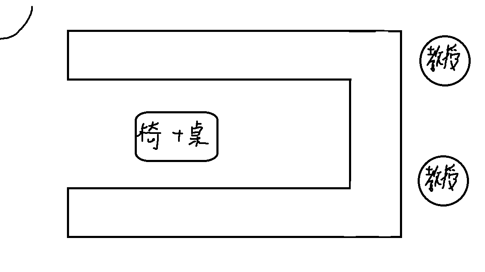

放榜結果：待公布

淡江資管採個人面試，分兩次面對兩個教授，一場5分鐘，共10分鐘。
剛到時會先前往商管樓簽到，之後做在門口等候，有學長把你帶上去。學長蠻好聊的，我也問他了一些奇怪的問題。

學長：你有什麼問題都可以問我。
我：好啊，那你們宿舍人怎麼樣?
學長：我覺得是還行啦，基本上人都還不錯。
我：那蟲蟲室友多嗎?
學長：（把我交給另外兩位學長然後跟他們說）他有很多重要的問題想問。
另外兩位學長：好啊，你有什麼問題想問嗎?
我：你們蟲蟲室友多嗎?
學長：（其中一位大笑）（另外一位說）原來重要的問題是這個嗎?
學長：看你抽到什麼樣的人吧，我覺得是還好，但是下雨的話會變得特別多，尤其是前幾天雨下很大，然後那個叫什麼，飛蟻也超級多的。那等等面試的時候不要緊張，裡面的教授人都很好的。

面試教室配置圖如下：

以下是一些我記得的問題還有回答。

（第一場）
教授：請開始一分鐘自我介紹。
我：各位教授好，我是來自陽明高中的馮宥誠。我在高一學習Python語言後，就對程式產生了極大的興趣，在高二時做了一篇Discord機器人的研究，並用它來執行算數學的功能，之後我又做了一篇專題，內容是在使用NLP技術，用BERT模型來辨識文字訊息的情緒，學測考完後，我又自學用 Github pages架設個人網站。
教授：你對你APCS成績滿意嗎?
我：我自己覺得不太滿意，因為我的目標是實作三級分，那我現在其實也有在繼續寫程式，學一些演算法之類的，然後我有報名7月APCS中高級，目標四級分。
教授：你英文程度覺得怎樣?
我：我在學校成績保持得還不錯，英文段考基本都有70上下。
教授：可是你把英文寫在你SWOT的Threat欸?
我：我們學校英文課程上比較少注重在閱讀這方面，比較少有在口說和聽力這方面做加強。
教授：可是你不是有參加交流嗎?
我：歐...就是因為對方也是學生，所以可能英文也不是很好，所以除了語言以外，還會透過肢體語言輔助。
教授：你有參加什麼大同的體驗營，你覺得如何?
我：自走車的那個，雖然時間很短，但我也成功讓自走車照路線走過關，我覺得蠻有趣的。那資安的部分，學了一些網域之類的東西，最後還有競賽，讓我學到不少。
（第二場）
教授：請開始簡單自我介紹。
我：各位教授好，我是來自陽明高中的馮宥誠。我在高一學習Python語言後，就對程式產生了極大的興趣，在高二時做了一篇Discord機器人的研究，並用它來執行算數學的功能，之後我又做了一篇專題，內容是在使用NLP技術，用BERT模型來辨識文字訊息的情緒，學測考完後，我又自學用 Github pages架設個人網站。
教授：你有報什麼科系?
我：都是資工和資管
教授：你有報什麼學校?
我：輔大、淡江和東華。
教授：你從哪裡來的?
我：北投。
教授：那不是淡江最近嗎?
我：對阿。
教授：那你會想來嗎?
我：我對東華印象挺不錯的，環境也不錯，而且我剛剛有問外面學長，宿舍有挺乾淨的，所以我會考慮。
教授：關於Discord的那篇專題是怎麼寫的?在哪執行?
我：我們是用python寫的，他有一個專門discord的插件，那他寫法很簡潔明瞭，所以這部份其實沒什麼問題，我們有創了一個Discord社群，並在裡面建一個機器人，讓他執行這個功能，讓大家都可以使用。
教授：第二篇專題你怎麼訓練模型的?
我：我們是自己蒐集了300多則訊息當做樣本，那為了知道這個準確度，我們訓練完成後會有一個train loss值，那這個值的計算原理就是在訓練完大部分資料後，取一小部分拿來考試，是用這個來計算精準度的。
教授：你是辨識什麼?
我：我們社群打出來的訊息文字。
教授：那他辨識後會怎樣?
我：如果辨識出來是正向，就會在訊息底下按一個讚的表情符號。如果是負向，就會按出倒讚。
教授：那這個模型準確度你覺得怎樣?
我：我們最後訓練到train loss值為0.3多，比我們第一次訓練的時候好很多，而且BERT模型是雙向讀的，所以辨識出來的結果本來就不差，自己測試下來也是挺準的。
教授：那反諷測得出來嗎?
我：因為我們的樣本本來就是我們的歷史訊息，我們有時候都會打這類的句子，所以應該還行。
教授：那「我真是謝謝你」這句話測得出來嗎?
我：不知道欸，這句話我沒測試過。
我覺得面試的還不錯，除了第一場我忘記我把英文寫道SWOT威脅裡面還有我參加過交流裡面寫說我口說聽力還不錯以外，其他講的都還不錯+_+
