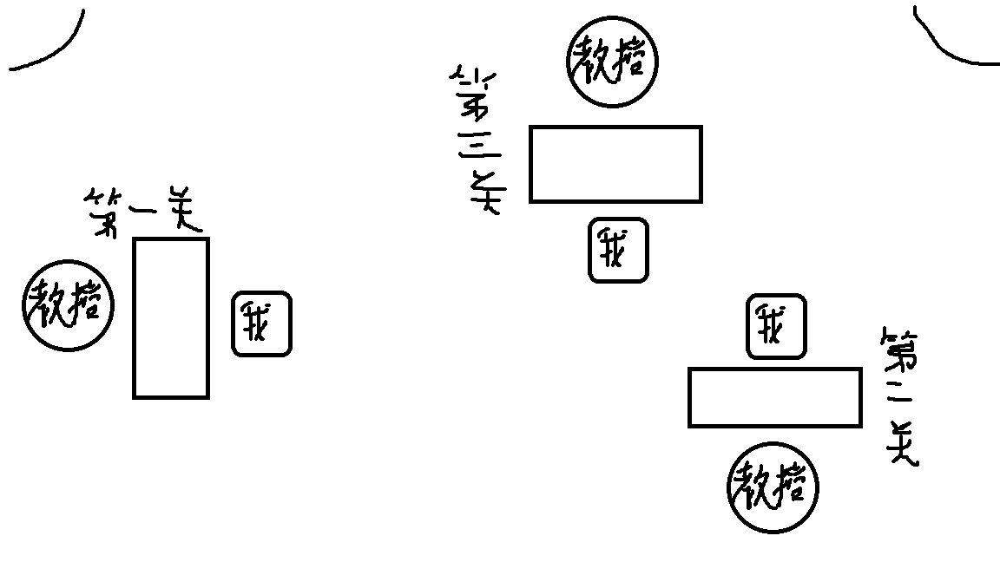
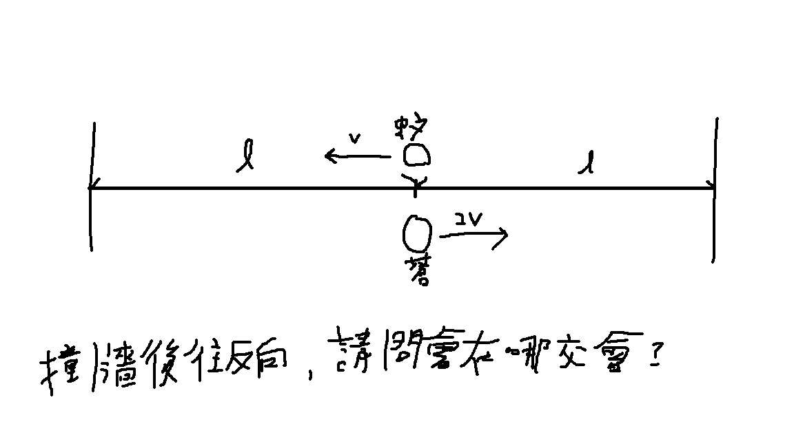

放榜結果：正取9

淡江資管採個人面試，分三次面對一個教授，一個教授5分鐘，共15分鐘。
剛到時會先前往商管樓5樓簽到，之後做在門口等候。
面試教室配置圖如下：

以下是一些我記得的問題還有回答。

（第一個教授）
教授：請開始一分鐘自我介紹。
我：各位教授好，我是來自陽明高中的馮宥誠。我在高一學習Python語言後，就對程式產生了極大的興趣，在高二時做了一篇Discord機器人的研究，並用它來執行算數學的功能，之後我又做了一篇專題，內容是在使用NLP技術，用BERT模型來辨識文字訊息的情緒，學測考完後，我又自學用 Github pages架設個人網站。
教授：你看起來東西做很多的，那你APCS幾分?
我：觀念題四級分、實作題三級分。
教授：那很厲害啊，你的在學成績也挺不錯的，而且你在AI專班歐，他怎麼進去的，是自願嗎?能介紹一下嗎?
我：他是看會考的數學跟英文成績，然後AI班其實不是自成一班，是在像專題課時才拉出去上。
教授：那你抽一個題目。（抽到在學校有什麼特殊表現）
我：我做了兩篇專題，第一篇是開發discord機器人算數學，第二篇是用BERT模型辨識文字訊息的情緒，那這兩篇我都有投小論文，分別拿到甲等和特優，然後我還有參加學校的數理資訊能力競賽資訊科技科，我拿到了全校第四名的成績。
教授：再抽一個題目。（自己的優缺點）
我：優點就是我有自學能力，像是我兩篇專題，還有我學測考完架的網站，其實都非常依賴自主學習能力，那缺點的話就是我在寫程式時很容易不細心，然後就會寫錯。（我隨便講得因為我想不到）
教授：不錯啊，但這應該不是缺點吧。去找下一位教授吧。
我：謝謝教授。
（第二個教授）
教授：你為什麼想填資管，為什麼填淡江，畢業後想做什麼?
我：因為首先就是淡江企業愛用度高，然後因為我對程式設計蠻有興趣的，在資管除了程式我還可以學到一些管理的技能，然後資管研究所有分科技類和管理類，所以如果我要繼續升學的話，應該也會走資訊相關，畢業後也會想在科技業工作。
教授：看你都是資訊的東西必較多，但是我們也有一些管理類的科目，那也要學歐。（拿了一個題目出來），請解這題，蒼蠅和蚊子會在哪裡交會?題目如下。

理論上這題應該很簡單，但教授說要寫公式、計算過程，然後我就不會了。
教授：好沒關係，你盡力了，那你能說他們在右邊還左邊交會嗎?
我：左邊。
教授：因為蒼蠅比較快嘛。那你APCS是最近考的嗎?
我：我是高二時去考的，但我現在還有再寫程式。
教授：為什麼?
我：我有報名7月的APCS。
教授：所以我剛剛其實應該要問你程式的題目對不對?那給下一個教授問好了，那我們先這樣。
我：謝謝教授。
（第三個教授）
教授：你從哪裡來?
我：北投，陽明山山腳下。
教授：那很近啊。你有報什麼科系?
我：都是資工和資管。
教授：你做過什麼專題?
我：第一篇是開發discord機器人算數學，第二篇是用BERT模型辨識文字訊息的情緒，那這兩篇我都有投小論文，分別拿到甲等和特優。
教授：那個情緒辨識是幹嘛的?
我：我們有創一個discord社群，然後使用者再輸入一段話後，他就會分析這個文字的情緒。
教授：他會有什麼動作嗎?
我：就如果是正向，就會在下面按一個讚的表情符號，負向就倒讚。
教授：你抽一個題目。（餐廳點餐換QRcode的看法）
我：好處是可以減少人力，不用人工再去點餐，壞處是可能有一些老人家不會用，到最後還是要店員來點。
教授：那還有什麼其他是你觀察到的嗎
我：（想不到）
教授：你填學校以什麼為優先?
我：交通方便之類的。
教授：你有填什麼淡江輔大外的學校嗎?
我：還有東華。
教授：那你覺得國立學校這個重要嗎?
我：不重要，因為其實國立學校分數不一定比較高，教授也不一定比較專業。
教授：你在偷講東華隊不對?（笑）
我：對不起歐。（笑）
教授：你為什麼不去填我們的人工智慧學系?
我：數A考太爛。
教授：那你能跟我說一個你會想來的理由讓我把你的分數打高一點嗎?
我：學校離家近，而且教授們看起來挺專業的，然後交通很方便，不像東華很偏遠。
教授：好啊，那今天面試就到這裡。
我：謝謝教授。
整體來說面試我都在亂回答，但教授說我APCS很高，成績也不錯之類的，而且教授人也挺好的。