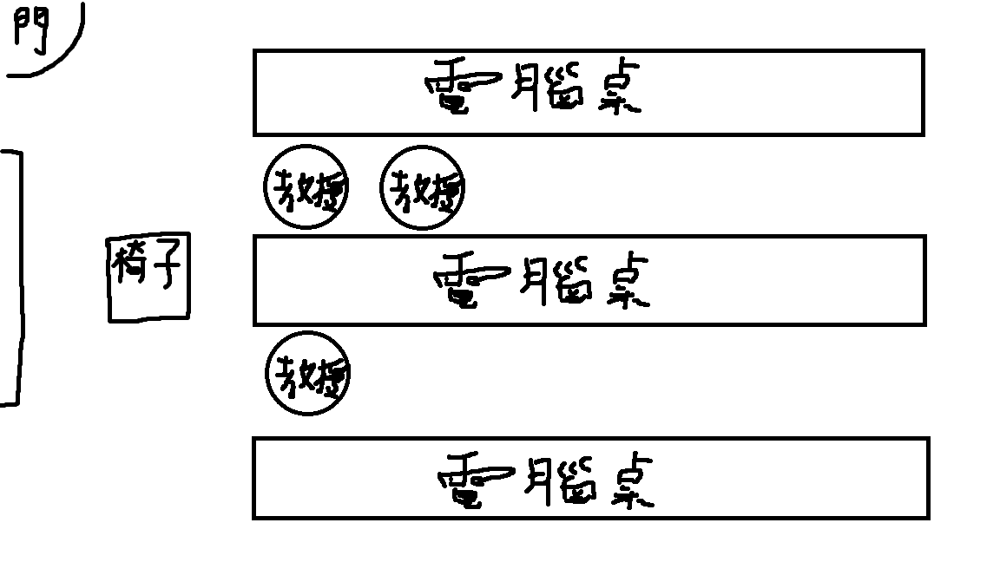

放榜結果：待公布

輔大資工採個人面試，我面試分配到丁組，一位考生面對三位教授，面試8分鐘。
剛到時會先前往資工系6樓簽到，時間到了會有人負責帶上去。
面試教室配置圖如下：

以下是一些我記得的問題還有回答

教授：請開始兩分鐘自我介紹。
我：各位教授好，我是來自陽明高中的馮宥誠。我會想進入資工系是因為我對程式設計與人工智慧這方面一直很有興趣，我在高二時做了一篇Discord機器人的研究，內容是用機器人來算高中數學公式，之後我又做了一篇專題，內容是在使用NLP技術，用BERT模型來辨識文字訊息的情緒，學測考完後，我又自學用 Github pages架設個人網站。我會選擇輔大資工系其中一個原因是因為資工有 CPC 程式競賽社團，且參加像 CPE 的檢定或程式，軟體設計競賽也有不錯的成績，所以我覺得貴校資工非常有潛力，我認為資工系除了課內知識外，也很重視自主學習與解決問題的能力，而我也很喜歡主動研究新技術、把學到的東西實際做出來，我認為我符合這個特質，所以我會想進入貴校的資工並加入CPC。
教授：你有做BERT這個專題對不對，你可以說一下這個東西跟AI的關聯嗎?
我：BERT就是一個大語言模型，可以拿來做情緒辨識這件事情，BERT在AI上是很重要的一環，那我拿同是AI的GPT來比較，像GPT他辨識是單向的，他不能在讀句子的時候同時看到前面又看到後面（這段我忘記我怎麼講了），像是「我今天很開心」這句話，GPT就只能先讀到「我」，然後獨到「今天」，最後才讀到「很開心」。但BERT不一樣，在這個句子中，在讀到「我」的同時，也可以讀到「很開心」，所以BERT就很適合文意理解之類的。（這段我怎麼講的忘得差不多了，總覺得我把題目帶歪了，有種學到政治人物回答問題的精隨(誤）
教授：那你知道機器學習嗎?
我：知道
教授：那你可以說明AI和機器學習的關聯嗎?
我：我可以用這領域在機器學習的例子去講嗎?
教授：可以
我：在這領域貢獻很多，像是現在的google翻譯，還有一些翻譯機器人其實都是AI訓練後的結果。
教授：你未來有什麼規劃嗎?像是想學什麼?
我：在大一時，我會先想把基礎打穩，學好演算法資料結構還等等，那大三大四的話我會比較想往硬體方面去學習。
教授：那你有比較想上哪位在上硬體相關的教授的課嗎?
我：我知道貴系在大三之後會有很多選修課程可以選擇，那其實有很多選修課都是跟硬體有相關的，但因為我只有看什麼課程，所以我不太知道是哪位教授教的課。（忘記準備了啊啊啊）
教授：如果有人用AI做作業你會有什麼看法?
我：我覺得當然不太應該，因為其他人辛苦自己做的作業，他用AI就寫完了。但是我覺得AI雖然會寫程式，但是一些人工除錯之類的，可能還是要真人來去做，AI可能沒有辦法完成，所以可能會露出破綻。
教授：那如果你交了作業，然後同學抄你的作業你會有什麼看法?
我：（露出一個很問號的表情然後笑，接著其他教授也笑出來）我可能會問他會什麼這樣做，然後可能會告訴老師。
教授：你的APCS有4,3的成績對不對而且你還有參加資訊能力競賽，那為什麼你會開始學習程式阿?
我：就是高一的時候我有加入AI專班，他那時候一開始就教了python程式，那時我就對程式語言充滿興趣（我不是這樣說的，但我記得我說得很好）。
教授：你們AI班是怎樣的，可以介紹一下嗎?（我忘記怎麼問了）
我：AI班其實不是自成一班，是在像專題可的時候才拉出去上的。
教授：你們有教什麼東西，有教演算法之類的嗎?
我：我們高二的時候有教一些演算法和資料結構，像是基本的二分搜、排序等等，我們高一的時候還有學一些概論的東西還有線性代數，然後因為我們學校有機械手臂，所以還有教一些手臂點為與視覺的操作，也有去參加機械手臂的比賽。
（計時器剛好響了）
教授：那我們今天就先問到這裡。
我：謝謝教授。

整體來說面試不太難，而且時間不多，所以也沒問很多。