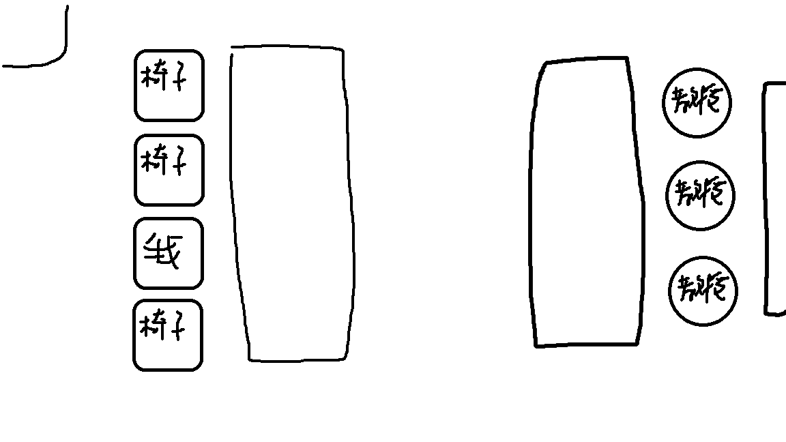

放榜結果：正取56

輔大資管採團體面試，我面試分配到A組，四位考生面對三位教授，面試20分鐘。
剛到時會先前往國璽樓11樓簽到，之後做在門口等候。
面試教室配置圖如下：

以下是一些我記得的問題還有回答，由於是團體面試，我只寫我被面試的部分。

教授：請每個人一分鐘輪流自我介紹。
我：各位教授好，我是來自陽明高中的馮宥誠。我在高一學習Python語言後，就對程式產生了極大的興趣，在高二時做了一篇Discord機器人的研究，並用它來執行算數學的功能，之後我又做了一篇專題，內容是在使用NLP技術，用BERT模型來辨識文字訊息的情緒，學測考完後，我又自學用 Github pages架設個人網站。我希望能經由貴系的訓練，提升自己。
教授：我看你APCS有4,3的成績，挺厲害的，那我就問你一些深度一點的問題歐，你能說明一下因為你專題有做辨識嘛，能說明一下語意理解嗎?
我：（我忘記我講什麼了）
教授：那你們有用什麼認證的資料庫去學習嗎?
我：我們是自己蒐集了300多則訊息當做樣本，那為了知道這個準確度，我們訓練完成後會有一個train loss值，那這個值的計算原理就是在訓練完大部分資料後，取一小部分拿來考試，是用這個來計算精準度的。
教授：你有用過什麼套件嗎?
我：AI班有學過pygame，所以我也會用pygame，然後我也有學習用Latex，就是排版變好看的。
（接著是每個人都要回答的問題）
教授：你們會想用資訊技術解決什麼問題或是怎麼給一些對社會有幫助的事?
我：首先就是資料整理，對於這種重複性高的工作，我就會想用資訊技術來解決，再來就是我會想自架一個網站，然後在裡面丟一些知識之類的，讓大家需要這些知識時，都可以藉由網站學習。
教授：那你放什麼類型的知識上去?
我：我會想丟一些程式，演算法之類的知識，或是APCS的詳解之類的，讓大家遇到不會的題目時，就可以看。
教授：現在沒有嗎?
我：有啊，但像我剛剛有提到我有架網站嘛，然後我就有放APCS三月的中高級解題紀錄。
教授：是你自己寫出來的嗎?
我：對
教授：那你現在瀏覽知道嗎?有多少人?
我：我是用github pages架的，我沒有特別注意到這個瀏覽人數。
（問完其他人後）
教授：那我們今天就先面試到這裡。
我：謝謝教授。

整體來說面試挺簡單的，而且教授是真的感覺有看過備審，教授人也挺好的，會讓沒想到的人慢慢想。